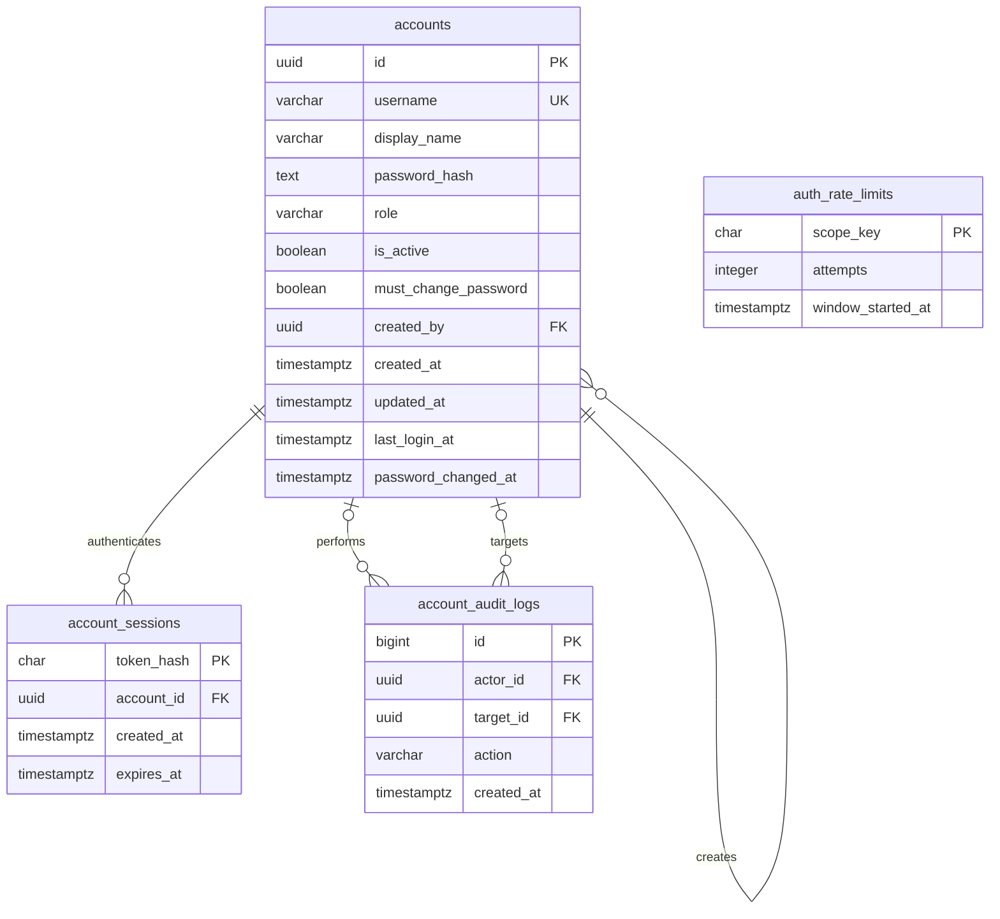

# PostgreSQL và tài khoản

Hệ thống sử dụng PostgreSQL 17. Người truy cập có thể tự đăng ký ở trang đăng nhập. Máy chủ luôn cấp role `user` cho tài khoản tự đăng ký và đưa người dùng vào trang học sau khi tạo thành công. Admin cũng tạo được tài khoản với role `user` hoặc `admin` trong màn hình quản lý.

## Chạy trên máy hiện tại

PostgreSQL portable đã được khởi tạo trong `.sites-runtime`, lắng nghe tại `127.0.0.1:55432`, database `hsk_master`. Thông tin kết nối nằm trong `.env.local` được Git bỏ qua. Dùng terminal tại thư mục `hsk-master`.

```powershell
.\hsk.cmd
```

Mở `http://127.0.0.1:5173`. Tài khoản admin ban đầu là `tungnx` với mật khẩu đã được cấp trong yêu cầu. Lần đăng nhập đầu tiên yêu cầu đổi sang mật khẩu có 8–128 ký tự. Mật khẩu bootstrap đã được xóa khỏi `.env.local` sau khi tạo tài khoản.

Script khởi động cả PostgreSQL và web bằng Node.js có sẵn. Để dừng PostgreSQL sau khi dừng web, chạy `.\hsk.cmd stop-db`.

## Dùng PostgreSQL khác

1. Tạo database PostgreSQL và sao chép `.env.example` thành `.env.local`.
2. Đặt `DATABASE_URL` và `APP_ORIGIN` tương ứng với địa chỉ web thực tế.
3. Đặt `MIGRATION_DATABASE_URL` nếu sử dụng tài khoản database riêng có quyền tạo bảng. Nếu để trống, migration dùng `DATABASE_URL`.
4. Chạy `npm run db:migrate`.
5. Đặt `BOOTSTRAP_ADMIN_USERNAME=tungnx` và `BOOTSTRAP_ADMIN_PASSWORD` theo mật khẩu khởi tạo bạn muốn dùng, rồi chạy `npm run db:seed`.
6. Xóa `BOOTSTRAP_ADMIN_PASSWORD` khỏi môi trường sau khi seed. Chạy lại seed với cùng username sẽ giữ tài khoản và mật khẩu đang tồn tại.

`DATABASE_URL` là bí mật phía máy chủ. Với kết nối từ xa, dùng chứng chỉ TLS hợp lệ theo hướng dẫn của nhà cung cấp. Bản Sites online cần PostgreSQL truy cập được từ môi trường hosting, `DATABASE_URL` trong runtime secrets và `APP_ORIGIN` là origin HTTPS của Site. Cần áp dụng migration và seed trên chính database đó trước khi đưa phiên bản đăng nhập lên online.

## Thiết kế dữ liệu

Schema SQL nằm tại [001_accounts.sql](../db/postgres/001_accounts.sql). Migration chạy trong transaction, dùng advisory lock để tuần tự hóa các lần cập nhật và lưu lịch sử vào `app_migrations`.



| Bảng | Dữ liệu và ràng buộc |
| --- | --- |
| `accounts` | UUID, username duy nhất đã chuẩn hóa chữ thường, hash mật khẩu, role, trạng thái và người tạo. Database kiểm tra role `user/admin` và định dạng username. |
| `account_sessions` | SHA-256 của token ngẫu nhiên 256 bit, tài khoản sở hữu và thời điểm hết hạn sau 7 ngày. Khóa ngoại tự xóa phiên khi tài khoản bị xóa. |
| `auth_rate_limits` | Số lần thử theo username hoặc tài khoản trong cửa sổ 15 phút. Dùng upsert để các yêu cầu đồng thời được đếm chính xác. |
| `account_audit_logs` | Ghi nhận ai tạo tài khoản nào và các lần đổi mật khẩu, có thời gian thực hiện. |
| `app_migrations` | Tên file migration đã áp dụng và thời gian áp dụng. |

Mật khẩu dùng PBKDF2-HMAC-SHA256 với salt ngẫu nhiên và 600.000 vòng. Cookie phiên có `HttpOnly`, `SameSite=Lax` và `Secure` khi dùng HTTPS. Máy chủ kiểm tra origin cho yêu cầu ghi dữ liệu, truy vấn SQL có tham số và kiểm tra role admin tại API. Đổi mật khẩu thu hồi các phiên cũ, đồng thời cấp phiên mới cho trình duyệt đang thực hiện.

Trên máy hiện tại, web dùng PostgreSQL role `hsk_app` chỉ có quyền thao tác dữ liệu cần thiết. `hsk_owner` phục vụ migration. Đây là các database role, còn `user/admin` là role của tài khoản trong ứng dụng.

## API

| Method | Đường dẫn | Quyền và hành vi |
| --- | --- | --- |
| GET | `/api/auth/session` | Đọc tài khoản của phiên hiện tại. |
| POST | `/api/auth/login` | Kiểm tra username/mật khẩu và tạo cookie phiên. |
| POST | `/api/auth/register` | Cho phép khách tạo tài khoản, luôn gán role `user`, ghi nhật ký và tạo cookie phiên trong một transaction. |
| POST | `/api/auth/logout` | Thu hồi phiên hiện tại và xóa cookie. |
| POST | `/api/auth/password` | Người đã đăng nhập xác minh mật khẩu hiện tại rồi đổi mật khẩu. |
| GET | `/api/admin/accounts` | Admin xem 200 tài khoản mới nhất. |
| POST | `/api/admin/accounts` | Admin tạo tài khoản, chọn tên hiển thị, username, mật khẩu ban đầu và role. |

Tiến độ học vẫn được lưu trên trình duyệt, tách riêng theo UUID tài khoản. Tiến độ cũ của bản trước đăng nhập được chuyển vào tài khoản `tungnx` khi dùng lần đầu trên cùng trình duyệt. Có thể xuất/nhập bản sao lưu trong Cài đặt học tập.
